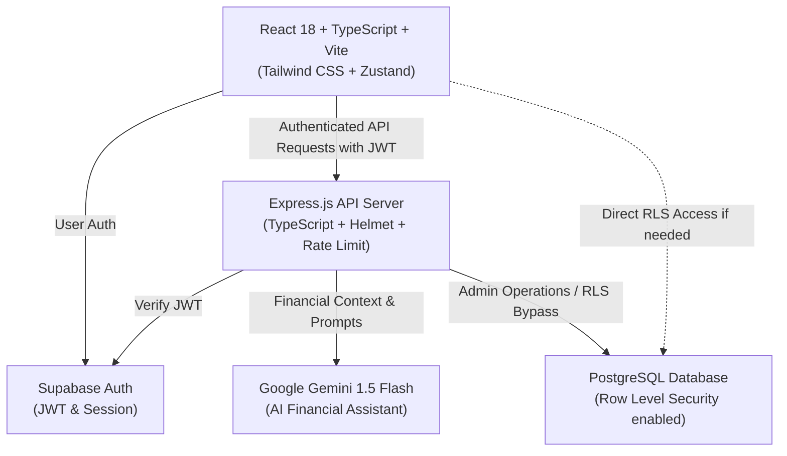

# 💰 MyKanakku (കണക്ക്) — AI-Powered Student Expense Tracker

[](https://reactjs.org/)
[](https://www.typescriptlang.org/)
[](https://nodejs.org/)
[](https://expressjs.com/)
[](https://supabase.com/)
[](https://www.postgresql.org/)
[](https://tailwindcss.com/)
[](https://ai.google.dev/)

A secure, modern, multilingual personal finance and expense tracking web application tailor-made for college and university students. **MyKanakku** ("Kanakku" means *accounts/calculations* in Malayalam and Tamil) empowers students to record expenses quickly through conversational natural language, track allowances, stay within category budgets, monitor savings goals, and understand their spending habits through visual analytics.

---

## 🌟 Key Features

### 1. 🤖 Dedicated AI Financial Assistant (Gemini 1.5 Flash)
- **Natural Language Expense Logging**: Type casually like `"Spent ₹120 on canteen lunch"` or in vernacular `"Auto 40 roopa cheythu"`, `"Aaj 200 rs book par kharch kiye"`.
- **Strict Financial Scope Enforcement**: Backend-enforced scope boundary. Refuses non-financial questions (homework, coding, trivia, entertainment) strictly.
- **Prompt Injection & Jailbreak Defense**: Multi-pattern injection detector blocks DAN mode, system prompt leakage, and role overriding attempts.
- **Confirmation-First Architecture**: AI extracts parsed transactions with confidence scores and presents them for **explicit user confirmation** before saving to PostgreSQL.
- **Real-Database Context**: Injects live balance, remaining category budgets, and savings goals into the AI prompt so financial advice is grounded in reality, never hallucinations.

### 2. 📊 Student-Centric Dashboard & Visual Analytics
- Real-time **Available Balance**, **Total Income**, **Total Expenses**, and **Net Cash Flow**.
- Dynamic period filtering: **Today**, **This Week**, **This Month**, and **Custom Date Range**.
- Interactive **Recharts** visualizations: Area charts for income vs. expense trends, category breakdown donut charts, and spending distribution.
- Budget overrun warnings with color-coded alerts (Normal, Warning >80%, Exceeded >100%).

### 3. 🎯 Budgets & Money Allocation
- Category-wise monthly and weekly budgets with visual progress indicators.
- Dynamic computation of actual spending directly from confirmed transactions.
- Instant feedback when nearing or exceeding limits.

### 4. 🐷 Savings Goals
- Set targets (e.g., *"Semester Fees"*, *"Laptop Fund"*, *"Hostel Deposit"*).
- Milestone tracking with progress percentages and days remaining.
- AI-suggested monthly contribution calculation based on deadline.

### 5. 🛡️ Security & Privacy First
- **Supabase Authentication**: Secure JWT handling, password reset workflows, and session persistence.
- **PostgreSQL Row Level Security (RLS)**: Enforced on all tables (`users`, `transactions`, `budgets`, `savings_goals`, `conversations`, `chat_messages`, `reminder_settings`).
- **Server-Side API Key Storage**: Gemini AI keys and Supabase Service Role keys are **never** exposed to the browser.
- **Input Validation & Sanitization**: Express-validator on all endpoints, helmet security headers, rate limiting, and audit logging.

---

## 🏗️ System Architecture



---

## 📁 Repository Structure

```
myKanakku/
├── backend/
│   ├── src/
│   │   ├── config/          # Supabase and environment config
│   │   ├── db/              # Migration and seed scripts
│   │   ├── middleware/      # Auth JWT verification and validation
│   │   ├── routes/          # Express route handlers
│   │   │   ├── auth.ts      # Authentication & audit endpoints
│   │   │   ├── users.ts     # Profile and settings
│   │   │   ├── transactions.ts # CRUD transactions with pagination
│   │   │   ├── categories.ts   # Categories & defaults
│   │   │   ├── budgets.ts      # Category budgets & computed spent
│   │   │   ├── savings.ts      # Savings goals & contributions
│   │   │   ├── conversations.ts# Chat conversation threads
│   │   │   ├── chat.ts         # AI messaging & transaction confirm
│   │   │   ├── dashboard.ts    # Dashboard aggregates & analytics
│   │   │   ├── reports.ts      # Spending reports & CSV export
│   │   │   └── reminders.ts    # Daily reminder settings
│   │   ├── services/
│   │   │   └── aiService.ts # Gemini AI client, prompt engineering & defense
│   │   ├── utils/           # Winston logger & audit logger
│   │   └── server.ts        # Express entry point
│   ├── tests/               # Security & API unit test suites
│   ├── package.json
│   └── tsconfig.json
├── database/
│   ├── migrations/
│   │   └── 001_initial_schema.sql # Complete PostgreSQL schema with RLS
│   └── seeds/
│       └── 001_categories_seed.sql # Student-focused default categories
├── frontend/
│   ├── src/
│   │   ├── components/      # UI components (shared, auth, charts)
│   │   ├── lib/             # Axios API client & Supabase client
│   │   ├── pages/           # Pages (Dashboard, Chat, Transactions, Budgets, Savings, Reports, Settings, Landing)
│   │   ├── store/           # Zustand stores (authStore, chatStore, dashboardStore)
│   │   ├── types/           # Complete TypeScript interfaces
│   │   ├── App.tsx          # Router and global layout
│   │   ├── main.tsx
│   │   └── index.css        # Premium dark mode & glassmorphism styles
│   ├── index.html
│   ├── tailwind.config.js
│   ├── vite.config.ts
│   └── package.json
└── README.md
```

---

## 🚀 Quick Start Guide

### 1. Prerequisites
- **Node.js**: v18 or higher (v20+ recommended)
- **Supabase Account**: A free Supabase project
- **Google AI Studio Account**: A free Gemini API key

### 2. Environment Setup

#### Backend (`backend/.env`):
```env
PORT=5000
NODE_ENV=development
ALLOWED_ORIGINS=http://localhost:3000,http://localhost:5173

# Supabase
SUPABASE_URL=https://<your-project-id>.supabase.co
SUPABASE_SERVICE_ROLE_KEY=<your-supabase-service-role-key>

# PostgreSQL connection string
DATABASE_URL=postgresql://postgres:<password>@db.<your-project-id>.supabase.co:5432/postgres

# Google Gemini AI
GEMINI_API_KEY=<your-gemini-api-key>
GEMINI_MODEL=gemini-1.5-flash
```

#### Frontend (`frontend/.env`):
```env
VITE_SUPABASE_URL=https://<your-project-id>.supabase.co
VITE_SUPABASE_ANON_KEY=<your-supabase-anon-key>
VITE_API_URL=http://localhost:5000/api
```

### 3. Database Migration
Run the SQL migration in your Supabase SQL Editor:
1. Open `database/migrations/001_initial_schema.sql` and execute in the Supabase SQL Editor.
2. Open `database/seeds/001_categories_seed.sql` and execute to populate standard student categories.

*(Alternatively, run `npm run migrate` and `npm run seed` in `backend/` if `DATABASE_URL` is configured).*

### 4. Running Locally

#### Start the Backend:
```bash
cd backend
npm install
npm run dev
```
Backend will start on `http://localhost:5000`.

#### Start the Frontend:
```bash
cd frontend
npm install
npm run dev
```
Frontend will start on `http://localhost:3000`.

---

## 🧪 Testing

### Backend Security & Unit Tests:
```bash
cd backend
npm test
```
Validates:
- Ownership validation and user isolation.
- Prompt injection and jailbreak blocking.
- Financial scope filter vs out-of-scope requests.

### Frontend Store Tests:
```bash
cd frontend
npm test
```

---

## 📜 License
MIT License. Built for students to take control of their finances with confidence.
